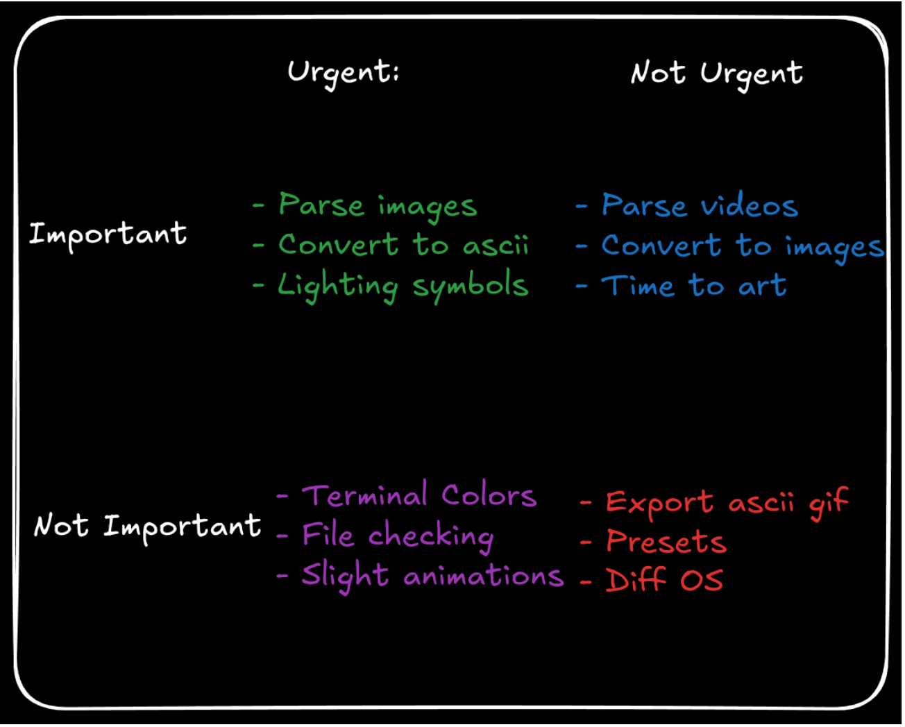
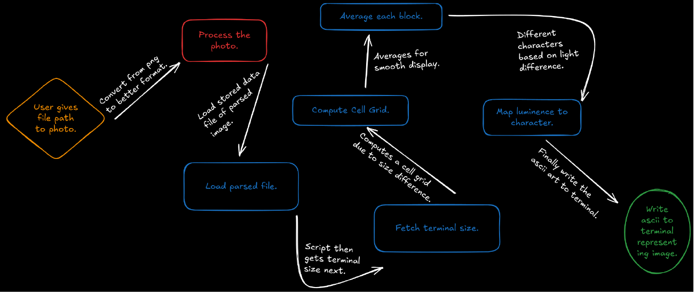

# TermPaint Build Plan

This is the detailed plan for building TermPaint. Nothing here is final.

## Goal
Take an image path, draw the image as ASCII art sized to the current terminal.

## Approach
- Python handles image decoding, since reading PNG/JPEG in assembly isn't practical.
- NASM does everything after that: loading, sizing, averaging, mapping, printing.
- A Python prototype of the NASM part comes first, as a reference to test against.

## Priorities


| | Urgent | Not urgent |
|---|---|---|
| Important | Parse images, convert to ASCII, lighting symbols | Parse videos, convert to images, time to art |
| Not important | Terminal colors, file checking, slight animations | Export ASCII GIF, presets, other OSes |

The MVP is the top-left box. Everything else waits until the MVP works.

## Pipeline


| Step | Diagram box | Language |
|---|---|---|
| 1 | User gives file path | NASM (argv) |
| 2 | Process the photo | Python |
| 3 | Load parsed file | NASM |
| 4 | Fetch terminal size | NASM |
| 5 | Compute cell grid | NASM |
| 6 | Average each block | NASM |
| 7 | Map luminance to character | NASM |
| 8 | Write ASCII to terminal | NASM |

## Step Details

### 1. User gives file path
- Usage: `termpaint <file.tpr>`.
- In NASM, `argc` is at `[rsp]` and `argv[1]` is at `[rsp+16]` on entry to `_start`.
- No argument: print usage to stderr and exit with code 1.

### 2. Process the photo (Python)
- Open the image with Pillow. Any format Pillow supports works (PNG, JPEG, BMP, GIF).
- If it has transparency, paste it onto a black background first.
- Convert to grayscale (`"L"` mode): `L = 0.299R + 0.587G + 0.114B`.
- Save it as a `.tpr` file (format below).

### The `.tpr` file format
Kept as simple as possible so NASM can read it with no parsing.

| Offset | Size | Contents |
|---|---|---|
| 0 | 4 bytes | Magic `TPR1` |
| 4 | uint32 LE | Width in pixels |
| 8 | uint32 LE | Height in pixels |
| 12 | width × height bytes | Brightness 0–255, row by row |

Expected file size: `12 + width * height`. Anything else means the file is broken.

### 3. Load parsed file
- `open` the file (syscall 2), then `fstat` (syscall 5) to get its size.
- `mmap` it (syscall 9) read-only, so there's no buffer to manage.
- Check the magic is `TPR1` and the size matches the header. On failure print an error and exit.

### 4. Fetch terminal size
- `ioctl(1, TIOCGWINSZ, &winsize)`: syscall 16, `TIOCGWINSZ = 0x5413`.
- `winsize` is four `u16` values: rows, cols, xpixel, ypixel.
- If it fails (for example when output is piped), fall back to 80×24.
- Keep one row free for the shell prompt.

### 5. Compute cell grid
- Each character covers a block of pixels. Terminal cells are about twice as tall as wide, so a block is `cell_w` wide and `cell_h = 2 * cell_w` tall.
- Start with `cell_w = ceil(width / term_cols)`.
- While `height / cell_h > term_rows - 1`, increase `cell_w`.
- Output size: `cols = width / cell_w`, `rows = height / cell_h`.
- Integer math only, so this maps straight onto `div`.

### 6. Average each block
- For each block, add up every pixel's brightness into a 64-bit register.
- Divide by `cell_w * cell_h` to get the average.
- Pixels left over at the right and bottom edges are dropped.

### 7. Map luminance to character
- Ramp, dark to bright: ` .:-=+*#%@` (10 characters).
- Index: `(avg * 10) >> 8`, which always lands in 0–9.
- Look the index up in a ramp table stored in `.data`.
- An invert option flips the ramp for light-background terminals.

### 8. Write ASCII to terminal
- Fill a buffer in `.bss`: one character per block, `\n` after each row.
- Send it all with a single `write(1, buf, len)` (syscall 1).
- Exit with code 0 (syscall 60).

## File Layout (planned)
| Path | Purpose |
|---|---|
| `src/preprocess.py` | Image to `.tpr` |
| `src/termpaint.py` | Python prototype of steps 3–8 |
| `src/termpaint.asm` | NASM renderer |
| `tests/` | pytest tests |
| `Makefile` | Builds the NASM binary |

Build command (planned):
```bash
nasm -f elf64 src/termpaint.asm -o build/termpaint.o
ld build/termpaint.o -o build/termpaint
```

## Testing Plan
- `.tpr` round trip: write then read gives the same pixels.
- Bad files: wrong magic and wrong size are rejected.
- Grid: output never goes past the terminal size.
- Averaging: small hand-made images give known averages.
- Mapping: brightness 0 gives ` ` and 255 gives `@`.
- Parity: NASM and Python print the exact same bytes for the same `.tpr`.

## Milestones

### Phase 0: Planning
- [x] Write the project scope
- [x] Sort features into the priority matrix
- [x] Draw the system diagram
- [x] Set up the environment (`environment.yml`, `requirements.txt`)

### Phase 1: Python prototype
- [ ] `preprocess.py`: image to `.tpr`
- [ ] Load and validate `.tpr`
- [ ] Terminal size with 80×24 fallback
- [ ] Cell grid
- [ ] Block averaging
- [ ] Brightness to character
- [ ] Print to terminal
- [ ] Tests for all of the above

### Phase 2: NASM renderer
- [ ] Makefile
- [ ] Read argv
- [ ] open / fstat / mmap the `.tpr`
- [ ] Validate the header
- [ ] ioctl for terminal size
- [ ] Cell grid
- [ ] Block averaging
- [ ] Ramp lookup
- [ ] Single write to stdout
- [ ] Parity tests against the Python version

### Phase 3: Important, not urgent
- [ ] Time to art: measure and print render time
- [ ] Parse videos: split frames with ffmpeg, redraw in place
- [ ] Convert ASCII back to an image

### Phase 4: Stretch goals
- [ ] Terminal colors (24-bit ANSI escapes)
- [ ] Better file checking and error messages
- [ ] Slight animations (fade in, line-by-line reveal)
- [ ] Export ASCII GIF
- [ ] Presets (block characters, longer ramps)
- [ ] Other OSes (macOS, Windows)

## Open Questions
- `mmap` or plain `read` for loading?
- Should Python preprocessing also downscale very large images?
- Store RGB in the `.tpr` now so colors are easier later?
